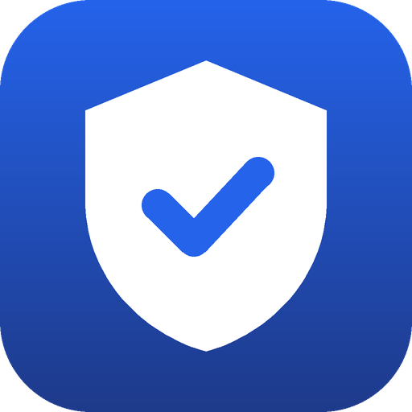
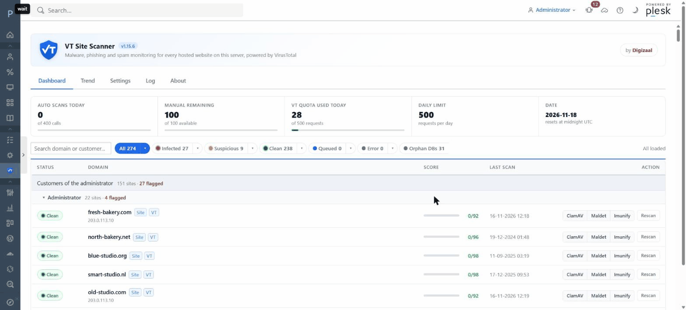
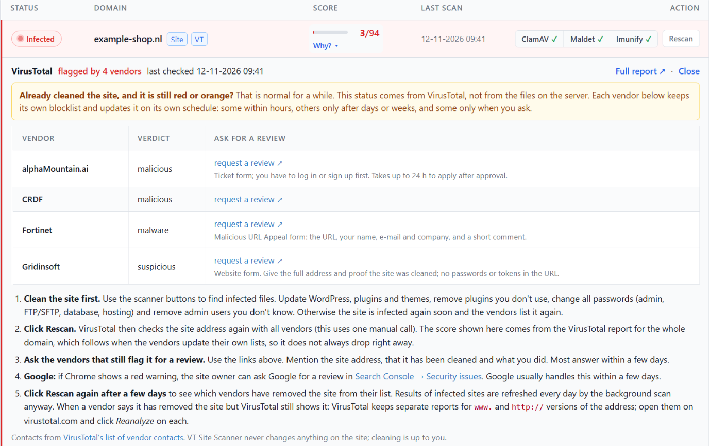
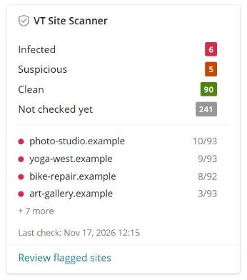
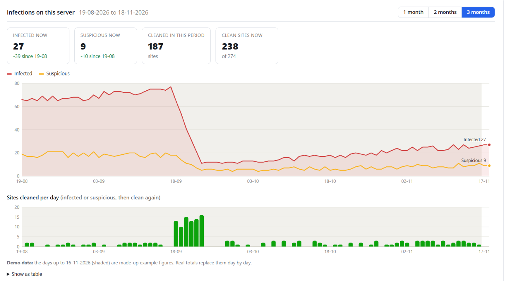

# StingyScan for Plesk

A Plesk extension that checks every website hosted on your Plesk server against [VirusTotal](https://www.virustotal.com)¹ for malware, phishing and spam, while carefully managing the limited number of API calls in VirusTotal's free tier. Optionally it also asks Google Safe Browsing¹ directly, and (experimental) the URL reputation of AVG and Avast¹.

<sub>¹ StingyScan is an independent product by Digizaal. It is not affiliated with, endorsed or sponsored by VirusTotal, Google, Gen Digital (AVG, Avast) or WebPros (Plesk). All trademarks belong to their owners; see [Trademarks](#trademarks).</sub>

Made by **Dirk Zaal** of **[Digizaal](https://www.digizaal.nl)**, a web development and hosting company in Amsterdam. *Stingy* because it is sparing with every API call. StingyScan was called **VT Site Scanner** until version 1.35; see [Coming from VT Site Scanner](#coming-from-vt-site-scanner-1x).

> **Detection only.** StingyScan never changes anything on your sites. It does not edit, clean, move, quarantine or delete files, and it does not change or delete databases. It only looks and reports, so you decide what to do. (The one thing it writes, on request, is a backup copy of an orphan database.)

> [!TIP]
> **Beta testers wanted.** Do you run a Plesk server with many websites, as a hosting company, agency or sysadmin? Try StingyScan for two weeks and tell us what you think. You get early access to new versions, direct contact with the developer, and a mention in this README if you like.
>
> **[Sign up as a beta tester](https://github.com/dzaal/StingyScan-for-Plesk/issues/new?template=beta-signup.yml)** · install with [one command](#installation) · **[send feedback](https://github.com/dzaal/StingyScan-for-Plesk/issues/new?template=beta-feedback.yml)**



## Who it's for

Hosting companies, agencies and server admins who look after **more sites than VirusTotal's free API can check in a day**. The free key allows 500 requests per day and 4 per minute. With 500 sites or more you can't check them all every day, and a simple scanner burns the whole quota before you get to the one site you just cleaned up.

StingyScan makes that quota go a long way:

- **Every site gets its turn.** The nightly scan picks up where it stopped the night before, so all sites are checked in rotation, however many there are.
- **Quota left for you.** Part of the daily budget is always kept for manual rescans.
- **No wasted calls.** Clean sites are re-checked after 30 days, infected or suspicious sites after 1 day.
- **One overview.** All sites with their status on one page and on the Plesk Home page, so a flagged site stands out right away.

## Screenshots

**Scanner dashboard:** every hosted website with its status, detection score and a Rescan button. The Scan Monitor shows what is being checked right now.


**Why is a site flagged, and how do you fix it?** Click the score of a flagged site: you see which security vendors flag it, a review link per vendor, and the steps from cleaning the site to getting it delisted.



**Card on the Plesk Home page:** counts per status and the sites flagged by the most engines, straight on the admin's Home page.

<p>
  
</p>

<details>
<summary>The card in context on the Plesk Home page</summary>


</details>

*Domain names and IP addresses in these screenshots are replaced with placeholders. The trend graph shows demo data.*

---

## Why this extension exists

Digizaal hosts about 600 WordPress sites on a single Plesk server. A single compromised site can harm its visitors, get the server's IP address blacklisted, and damage the reputation of every other site on it, so we need to know early when a site has been flagged.

With that many sites, VirusTotal's free API quota (500 requests per day) runs out every single day: checking every site even once takes more than a day, and rescans of infected sites come on top of that. Plesk ships with its own VirusTotal integration (*VirusTotal Website Check*), but every day it reported that the API calls were exhausted and not all sites had been scanned, leaving the rest unscanned, with no control over which sites were checked or when. That left no room to rescan a site after cleaning it up, which is the moment you need it most.

StingyScan was built to fix that:

- **Careful with API calls.** Every call goes through a rate limiter, results are cached, and the daily budget is split between background scans and manual rescans.
- **Interactive.** A live dashboard shows all sites, grouped by reseller and customer (click a customer to fold its sites away; the search box also finds customers), lets you filter on infected or suspicious ones, and rescans a site on demand, with a Scan Monitor that shows each step of each scan.
- **Hands-off.** A nightly background scan works through all sites in turn and picks up where it left off the night before.

## Features

- Dashboard with every website hosted on the server (WordPress or not): status (Infected / Suspicious / Clean / Queued / Error), detection score (e.g. `3/93` engines), IP address, domain age and danger tags (malware, phishing, …), with direct links to the site and to its VirusTotal page.
- **Home page card** for the Plesk admin (Plesk 18.0.60 or newer): infected / suspicious / clean counts and the worst-scoring sites, styled like Plesk's own cards. It reads cached results only and never uses API calls. Show or hide it via **Home → Customize → Security → StingyScan**.
- **Scan Monitor**: a panel on the right that shows the VirusTotal lookups and file scans that are running, waiting and finished, each with its steps and result (blue = VirusTotal running, amber = file scan running, green = done and clean, red = failed or infected). The pause for VirusTotal's 4-requests-per-minute limit is waited out automatically instead of failing. Click its header to open or close it.
- **Rescans keep going when you leave the page.** A rescan is also queued on the server, and a task that runs every 5 minutes finishes it if the browser was closed first.
- **Group or Sort:** sites grouped by reseller and customer, or one flat list. Click the **Domain**, **Score** or **Last scan** header to sort (within each group in Group mode). Mode, sort column and direction are remembered. *Last scan* shows how long ago the site was checked, with the exact time on hover.
- **Details per site:** click anywhere on a site's row (or its score) to open its details: the vendors that flag it with review links, Google Safe Browsing and AVG / Avast if switched on, and the history of the site. Click again to close.
- **History per site:** when it was first detected, when vendors started or stopped flagging it, status changes and every review request (see [Cleaned, but still red?](#cleaned-but-still-red)).
- **Optional Google Safe Browsing**, Google's official API: every site each night and live when you open its details (see [Google Safe Browsing](#google-safe-browsing-optional)).
- **Optional AVG / Avast Web Shield** classification (experimental), asked live (see [AVG / Avast Web Shield](#avg--avast-web-shield-optional-experimental)).
- **Update check:** when a newer version is on GitHub, a yellow banner appears with the release notes and, for the administrator, an **Install** button that upgrades the extension in one click.
- **Nightly background scan** (03:00, server time), scheduled automatically through Plesk's own scheduler.
- **Trend graph:** infected, suspicious and cleaned sites per day over the last 1, 2 or 3 months, for the whole server, per reseller or per customer (see [Trend](#trend)).
- **Helps you solve it, not just report it.** Click the score of an infected or suspicious site to see which vendors flag it, with a link per vendor to ask for a review (see [Cleaned, but still red?](#cleaned-but-still-red)).
- **E-mail notifications:** one summary e-mail with status changes and the full list of infected sites (see [Notifications](#notifications)).
- **Works for every Plesk user level:** administrator, reseller and client (see [Users and roles](#users-and-roles)).
- **Category menus:** the small arrow next to each status button (All, Infected, Suspicious, …) opens a menu with **Rescan**, which rescans every site in that category, worst first and never more than today's manual budget allows. The menu next to **All** also has **Refresh site list**.
- **File scanners on demand:** a button bar on every site for the malware scanners found on the server (ClamAV, maldet, Imunify). Results and infected files appear right under the site (see [File scanners](#file-scanners-clamav-maldet-imunify)).
- **Log tab** with a colour-coded scan log, and **log rotation** so the logs stay small (see [Settings](#settings)).
- **About tab** about the maker, with a *Buy me a coffee* button.

## File scanners (ClamAV, maldet, Imunify)

VirusTotal judges a site from the outside (its URL and domain). To look inside a site, every row has a small **scanner bar** with one button per malware scanner found on the server. The extension detects what is installed and only shows those buttons:

| Button | Scanner | What a click does |
|---|---|---|
| **ClamAV** | [ClamAV](https://www.clamav.net) | Scans the site's document root. Uses a running `clamd` (for example the one for mail scanning) via `clamdscan --fdpass`, so signatures are not loaded again; otherwise `clamscan`. |
| **Maldet** | [Linux Malware Detect](https://www.rfxn.com/projects/linux-malware-detect/) | Runs `maldet -a` on the document root only (the temp folders maldet normally adds are skipped). Uses ClamAV's engine when it is installed. |
| **Imunify** | ImunifyAV / Imunify360 | **Starts no scan.** Shows the result of Imunify's own latest scan of the site, including files Imunify has already cleaned. |

Clicking a button opens a second line under the site. It shows the scan while it runs, then the result and the list of infected files with the signature that matched. Click the button again (or **Close**) to fold it away; the button keeps a mark: ✓ for clean, a red number for infected files. **Scan again** runs a new scan.

- **On demand only.** A scan runs when you click, never by itself. One scan runs at a time on the server; a click while another scan is busy waits its turn and starts by itself. You can leave the page; the scan keeps running.
- **Detection only.** The extension asks every scanner to report, never to clean, quarantine or delete. maldet runs with its own quarantine setting, which is off by default; leave `quarantine_hits=0` in `/usr/local/maldetect/conf.maldet`.
- **Why Imunify is read-only:** Imunify handles what it finds according to its own settings (*Default action on detect*, for example *cleanup*). Starting an Imunify scan from here could therefore change files, so the extension only reads its results.
- Scans run at low CPU and disk priority. A large site takes a few minutes (about 17,000 files took 5–6 minutes with ClamAV in testing).
- Scans from this extension run one at a time. maldet's own daily cron scan (installed with maldet) runs outside the extension and can overlap with a scan you start here.
- Scanners don't always agree, and VirusTotal can flag a site for spam or phishing content in its database while its files are clean. Signatures starting with `PUA.` or `Heuristics.` are often false alarms.

### Settings and request rates

Every optional online service and every internal scanner has its own **1–5 requests/minute** limit (default **2**), shared by all users and browser tabs. Cached results use no request. New checks wait for their turn; internal file scans run one at a time.

### Switching scanners on and off

**Settings → Internal serverside file scanners** lists every scanner the extension knows (ClamAV, Maldet, Imunify), with what was found on the server:

- **Installed**, with how it will be used: for ClamAV a running `clamd` (and its config file) or `clamscan`; for maldet and Imunify the program path. Imunify is marked *results only*.
- **Not installed on this server**: the switch is greyed out and there is no button for it on the sites.

Each installed scanner has an on/off switch. A scanner that is switched off gets no button on any site, its earlier results are hidden, and it cannot be started. The setting is saved right away and applies to the whole server, so it is the same for every user; only the administrator can change it. Resellers and customers see the list, but the switches are locked for them.

The extension checks which scanners are installed once an hour. After you install or remove a scanner, click **Detect again** to update the list immediately. A newly found scanner is switched on.

How it works: website files belong to the subscription users, so the scans run through a small root helper (`sbin/site-scan`) that Plesk installs with the extension and calls through its own `callSbin` mechanism. The helper only accepts a scanner name and a hostname, and looks up the folder in Plesk's database. Each scanner is a small adapter in that file (detect, scan, read the result), so another scanner can be added the same way.

## Settings

The **Settings** tab, from top to bottom (text in Settings is never lighter than rgb(32, 32, 32), for easy reading):

- **VirusTotal**: the API key, with a green check *API key active* when VirusTotal accepts it (a red cross when it doesn't).
  - **Daily API budget**: the number of VirusTotal calls made today, large, split into background scan and manual rescans.
  - **Max calls / day** (default 500, the free tier).
  - A slider with a thin black line: left of it is the **background scan**, right of it is **reserved for manual scans (%)**. Each part is coloured and shows in orange how much of it was used today.
  - How long clean and infected results are cached.
- **Google Safe Browsing** (administrator): on/off, API key with green check, calls today, requests per minute, and how to get a key with direct links to the Google Cloud Console. See [Google Safe Browsing](#google-safe-browsing-optional).
- **External reputation checks – Experimental** (administrator): **AVG Web Shield** and **Avast Web Shield**, each with its own switch, calls today and requests per minute. See [AVG / Avast Web Shield](#avg--avast-web-shield-optional-experimental).
- **Internal serverside file scanners**: ClamAV, Maldet and Imunify, see [File scanners](#file-scanners-clamav-maldet-imunify).
- **Sites to scan**: all hosted websites, or WordPress sites only.
- **Notifications**: see [Notifications](#notifications).
- **Log rotation** (administrator, whole server): a scan log larger than the limit (default **5 MB**) is compressed to an old copy (`cron_<user>.log.1.gz`, `.2.gz`, …) and a new log is started; at most **5** old copies are kept, none older than **90 days**. The limits apply to each log file (every Plesk user has their own). Checked every 5 minutes and before the nightly scan.

Each online service has its own coloured block with its logo, so you see at a glance which service a setting belongs to.

## Users and roles

StingyScan works at all three Plesk user levels: **administrator**, **reseller** and **client**. Each user opens it from their own Plesk panel and only ever sees their own sites.

| Level | Sees |
|---|---|
| **Administrator** | Every hosted site on the server |
| **Reseller** | Their own sites and those of their customers |
| **Client** | Only their own sites |

Every user has their own settings: API key, budget, sites to scan and notifications. Users without an API key of their own automatically use the administrator's key.

## Notifications

In **Settings → Notifications**, each user can switch on e-mail for when one of their sites changes status:

- **When a site becomes:** Infected, Suspicious, and/or Clean again (only after it was infected or suspicious, so a first clean result doesn't count).
- **Send to:** one e-mail address. Leave it empty to use the address of your Plesk account.

You don't get an e-mail per site. Changes are collected and sent as **one summary e-mail** with:

1. the status changes (old → new status, score, and the vendors that flag the site), and
2. the full list of your sites that are **infected right now**, plus the suspicious ones.

The summary goes out at the end of the nightly scan, and during the day 10 minutes after a change, so several changes share one e-mail. A site that flips back to its old status before the summary is sent is left out. **Send test e-mail** sends a sample summary with your current infected list.

Mail is sent with the server's own mail system (PHP `mail()` via sendmail), from the administrator's e-mail address. Keep in mind that a single vendor flagging a site can be a false alarm, so check a site before alarming its owner.

## Trend

The **Trend** tab shows how infections develop, per day, over the last **1, 2 or 3 months**. The administrator sees the whole server; a **reseller** sees only their own customers and sites, and a **customer** only their own sites:

- **Infected** and **suspicious** sites per day, as lines.
- **Sites cleaned per day**: sites that were infected or suspicious and are clean again, as bars.
- At the top: infected and suspicious now, with the change since the start of the period; how many sites were cleaned in the period; and the number of clean sites.
- Hover over a day for its figures, or open **Show as table**.
- **Recent status changes**, newest first, one line per change: the date (time), the status before and after as coloured badges with a solid arrow between them (green = better, red = worse), and the site, for example `20-11-2026 (11:10)  [Infected] ➡ [Suspicious]  flower-centrum.example`. Click the site to open its VirusTotal report. A site that was infected or suspicious and leaves the site list (deleted, disabled or suspended in Plesk) shows as *Left the list*. Changes from before this list existed are filled in once from the scan logs.



*This screenshot uses demo data (the shaded part): many infected sites, a big clean-up two months ago, and a slow rise since.*

The totals are saved once a day: by the nightly scan (for the server, every reseller and every customer), and whenever someone opens the dashboard. The history is kept for about a year in the data folder (`vt_history.json` for the server, `vt_history_r_<login>.json` per reseller, `vt_history_c_<login>.json` per customer). Demo data is only added when you run the demo script below.

To see what the graph looks like before there is any history, you can fill the last 92 days with made-up example data (clearly marked as *demo*, shaded in the graph, and replaced by real totals day by day):

```bash
sudo -u psaadm /usr/local/psa/admin/bin/php /usr/local/psa/admin/plib/modules/stingyscan/scripts/seed_demo_history.php
```

Options: `--resellers` also fills every reseller's history, `--customers` every customer's. The demo figures are scaled to the number of sites (never more infected sites than there are) and end at today's real totals. `--remove` deletes all demo days again, everywhere. Resellers and customers see the same *Demo data* note and shading, so they can tell it's example data.

## Orphan databases

The **Orphan DBs** button next to the status filters (shown only when there are any) opens a separate list, WordPress databases on the server for a hostname under one of your domains that doesn't exist in DNS: usually old copies, test or staging sites (`staging.`, `test.`, `2025.`, …) whose database was never removed.

Nobody can visit them, but VirusTotal often still has them on file, sometimes as infected, and an old copy that is never updated is an easy target. Per hostname you see:

- **The database**, the number of tables and their **size**, and the subscription it belongs to.
- **Whether a live site still uses it** (the extension reads the `wp-config.php` files on the server):
  - *No WordPress install on this server uses this database*: the whole database can go.
  - *Old tables inside a database a live site uses*: the old copy shares a database with a live site, under its own table prefix (for example `WzyRCpCbc_*`). **Delete only those tables, never the database**, or the live site goes down.
  - *A WordPress install on disk uses these tables*: check before deleting anything.
- The VirusTotal **score**, **Why?** and **Rescan**, as for any other site. They are not looked up automatically, to save API calls. There is no file scan button, because there are no files.

Buttons (administrator only):

- **Back up** makes a `.sql.gz` copy of the database, or only of the old tables, in the subscription's `private/vt-db-backups/` folder, owned by the subscription's user. Nothing is deleted.
- **Delete in Plesk ↗** opens the subscription's **Databases** page in Plesk. Delete the database there, or use phpMyAdmin from that page to drop only the old tables.

StingyScan never deletes anything itself. After you delete a database, the hostname disappears from the list within a day, or right away with **Refresh site list** in the menu next to **All**.

## Cleaned, but still red?

A red or orange site raises two questions for the webmaster: *who* says the site is unsafe, and *how* do I get that changed once the site is clean? StingyScan answers both on the same screen, so you don't have to search for each vendor's support page yourself.


The status in StingyScan comes from **VirusTotal**, not from the files on your server. VirusTotal shows what dozens of security vendors think of a site, and **each vendor keeps its own blocklist** and updates it on its own schedule. So after you clean a site, it can stay *infected* or *suspicious* in the dashboard for a while: sometimes hours, often days, sometimes weeks, and some vendors only remove a site when you ask.

Click a flagged site's row, or its **score** (for example *8/92 · Why?*). A second line opens with:

- **The vendors that flag the site** and what they call it (for example *Fortinet: malware*).
- **A review link per vendor**: a form or e-mail address where you can report that the site is clean. The contacts come from [VirusTotal's list of vendor contacts](https://docs.virustotal.com/docs/false-positive-contacts); where a vendor has its own form for websites, that form is used instead (for example [alphaMountain](https://www.alphamountain.ai/false-positive/) and [Gridinsoft](https://portal.gridinsoft.com/false-positive)). For a vendor that is not in the list, the link goes to VirusTotal's list.
- **Which vendors you already asked.** A click on a review link is remembered per site and per vendor, with the date and time and who clicked (*✓ Requested 21-11-2026 (22:58) by admin · denied · undo*). When a vendor turns the request down (for example because the site was added to its list less than a day ago), click **denied** and optionally give the reason: the note disappears so you can ask again later, and the history keeps *Review denied* with the reason. *Undo* is for a click made by mistake. It is saved on the server (`vt_reviews.json`), so everyone who manages the site sees it. The header shows at how many of the flagging vendors a review was requested.
- **The history of the site**, newest first: when it was first detected (score and vendors), when each vendor started or stopped flagging it, its status changes, and every review request: which vendor, via website form or by e-mail (and to which address), and by whom. Clean sites that have a history get a **History** button on their score. Saved in `vt_sitelog.json`; the first detection of each site is filled in once from the scan logs.
- **The steps to get delisted:**
  1. **Clean the site first.** Use the file scanner buttons to find infected files. Update WordPress, plugins and themes, remove unused plugins, change all passwords (admin, FTP/SFTP, database, hosting) and remove unknown admin users. Otherwise the site is soon hacked and listed again.
  2. **Click Rescan.** VirusTotal checks the site address again with all vendors (one manual API call). The score in the dashboard comes from VirusTotal's report for the whole domain, which follows when the vendors update their own lists, so it does not always drop right away.
  3. **Ask the vendors that still flag it for a review**, using the links. Mention the site address, that it has been cleaned and what you did.
  4. **Google:** if Chrome shows a red warning, the site owner can request a review in [Google Search Console → Security issues](https://search.google.com/search-console/security-issues).
  5. **Rescan again after a few days** to see who has removed it. Infected and suspicious sites are also re-checked daily by the background scan. If a vendor says it has removed the site but VirusTotal still shows it, open the `www.` and `http://` versions of the address on virustotal.com and click **Reanalyze** on each: VirusTotal keeps a separate report for each version.

**Vendors that often flag websites**, and where to ask for a review (checked November 2026):

| Vendor | Where | Notes |
|---|---|---|
| alphaMountain.ai | [false-positive page](https://www.alphamountain.ai/false-positive/) | Ticket form; you have to log in or sign up. After approval it takes up to 24 hours to apply; then reanalyze on VirusTotal. Many site owners complain about slow answers. |
| Gridinsoft | [portal.gridinsoft.com/false-positive](https://portal.gridinsoft.com/false-positive) | Gridinsoft's own form for websites (not their support desk). Give the full address and proof the site was cleaned. Gridinsoft also looks at other vendors' verdicts, so ask the others first. |
| Fortinet | [Malicious URL Appeal](https://www.fortiguard.com/faq/malurl) | Web form: the URL, your name, e-mail and company, and a comment. (Not the "classification dispute" form, which is for software.) |
| Sophos | [Submit a sample](https://support.sophos.com/support/s/filesubmission) | Choose *Web Address (URL)*; no Sophos account needed. Usually 24–72 hours; you may not get a reply. |
| BitDefender | [bitdefender.com/submit](https://www.bitdefender.com/submit) | Choose *False positive* and *URL*; mention you own the site and add the VirusTotal link. |
| CRDF | [false-positive form](https://threatcenter.crdf.fr/false_positive.html) | Web form. |
| G-Data | [submit a URL](https://www.gdata.de/help/en/general/GeneralInformation/submitFileAppURL/) | Web form. |
| Lionic | [report a false positive](https://www.lionic.com/supports/report-false-positive/) | Web form. |
| Chong Lua Dao | [report a mistake](https://chongluadao.vn/en/report/reportmistake) | Complaint form for mislabelled sites. |
| Trustwave | [VirusTotal detection review](https://support.trustwave.com/virustotal-detection-review/) | Web form. |
| Bfore.Ai PreCrime | [ticket form](https://portal.bfore.ai/knowledge-base/kb-tickets/new) | Ticket form. |
| Webroot | [change request](https://support.threatintel.opentext.com/tools/change-request.php) | Web form. |
| SOCRadar | vt@socradar.io | No form; e-mail with the VirusTotal link. Site owners report that it works. |
| CyRadar | virustotal@cyradar.com | No form; e-mail with the VirusTotal link. |
| MalwareURL | team@malwareurl.com | No form; e-mail with the VirusTotal link. |
| Google Safe Browsing | [Search Console → Security issues](https://search.google.com/search-console/security-issues) | For the site owner; otherwise the [report form](https://safebrowsing.google.com/safebrowsing/report_error/). |

For vendors with only an e-mail address, the link in the extension opens an e-mail with the subject and a short message already filled in, including the VirusTotal link. If a vendor has confirmed the removal but VirusTotal still shows it after reanalyzing, you can send that confirmation to VirusTotal through its [false positive page](https://docs.virustotal.com/docs/false-positive).

The extension does not send review requests itself: each vendor has its own form or address, and a request should come from someone who can vouch that the site is clean.

## Google Safe Browsing (optional)

[Google Safe Browsing](https://safebrowsing.google.com) is Google's list of unsafe sites (malware, phishing, unwanted software, harmful apps). Chrome, Firefox and Safari use it to warn visitors, so a listed site loses visitors right away. VirusTotal also shows a Google Safe Browsing verdict, but asking Google directly gives a fresh answer, uses no VirusTotal calls, and links straight to the right review page.

**Set it up** (administrator, once for the whole server):

1. In the [Google Cloud Console](https://console.cloud.google.com/projectselector2/home/dashboard), open or create a project.
2. [Enable the Safe Browsing API](https://console.cloud.google.com/apis/library/safebrowsing.googleapis.com).
3. [Create an API key](https://console.cloud.google.com/apis/credentials) (*+ Create credentials → API key*) and restrict it: *API restrictions* → only **Safe Browsing API**; *Application restrictions* → **IP addresses** → your server's outgoing IP address.
4. In **Settings → Google Safe Browsing**, tick the switch, paste the key and click **Save settings**. The key is first tested with Google's own test page (always listed as phishing); a key that doesn't work is not saved and you see Google's error. A green check *API key active* shows it works. The key is stored on the server and never sent to the browser.

**What it does:**

- **Every night** all sites are checked, up to 250 per request (the `https://` and `http://` address of each), before the VirusTotal scan.
- **Live** when you open a site's details or rescan it.
- A listed site gets a red badge such as *Google: Phishing* and a **Google Safe Browsing (direct)** row in the vendor table, with a link to [Search Console → Security issues](https://search.google.com/search-console/security-issues) to request a review after cleaning. The click is remembered like the other review links.
- Listing and delisting go into the site history and **Recent status changes**; clean results don't, so the feed is not flooded.
- Google's terms do not allow treating a site as unsafe on information older than 30 minutes. A result is therefore used for 30 minutes at most; after that it is shown as *last known* and checked again when you open the details.
- **Limits:** Google gives every project a default quota; see the [Quotas](https://console.cloud.google.com/apis/api/safebrowsing.googleapis.com/quotas) page of the API, where you can also ask for more. The nightly check needs 1 request per 250 sites. When Google answers *quota exceeded*, all checks pause for 10 minutes.

> Google allows the Safe Browsing API for **non-commercial use only** ([terms](https://developers.google.com/safe-browsing/terms)). For commercial use Google offers the paid [Web Risk API](https://cloud.google.com/web-risk). Only the site addresses are sent; Google may use them to improve its services.

Results are kept in `vt_gsb.json`, calls per day in `vt_gsb_state.json`.

## AVG / Avast Web Shield (optional, experimental)

VirusTotal's list does not always show what AVG and Avast think of a site, while many visitors use those products. In **Settings → External reputation checks** the administrator can switch on **AVG Web Shield** (product 147), **Avast Web Shield** (product 146) or both. It asks the URL reputation service those products use themselves (their antivirus Web Shield and browser extensions) how they classify each site, for example `URL:Botnet`. Only that service is asked; the sites themselves are not visited.

> **Unofficial.** There is no public API for this; the format was worked out by hand and may change or stop working at any time. When it does, the result shows *Check failed* and nothing else is affected.

- **Live, not in the background.** The check runs when you open the details of a site and after every rescan. A result of the last 5 minutes is reused; *check again* asks right away. Each product has its own requests-per-minute limit (default 2), and there is never more than one request per second for the whole server. On HTTP 429 all checks pause for the *Retry-After* time (at least 60 seconds). Settings shows the number of calls made today for each.
- **What you see.** AVG and/or Avast are rows of the vendor table in the details, marked *(direct)*: the classification with its detection name, *No classification received*, or *Check failed* with the reason. A classified site also gets a red badge such as *AVG: Botnet* under its status. For a false positive there is a link to the official form ([Avast](https://www.avast.com/report-false-positive), [AVG](https://www.avg.com/en-us/report-false-positive)); you submit it yourself and choose **URL** in the form.
- **History.** The site history and **Recent status changes** note when the classification appears, changes or goes away.
- The latest result per site is kept in `vt_avast.json`.

## How it saves API calls

VirusTotal's free API allows **4 requests per minute** and **500 requests per day**.

| Mechanism | What it does |
|---|---|
| Global rate limiter | Counts every request per API key across all users and never sends more than 4/min or 500/day. |
| Result cache | Clean sites are re-checked after 30 days, infected or suspicious sites after 1 day (both configurable). Opening the dashboard reads from the cache and costs no API calls. |
| Daily budget split | By default 80% of the daily limit is reserved for the nightly scan and 20% for manual rescans. |
| Round-robin queue | The nightly scan continues where it stopped the night before, so even with hundreds of sites every site is still checked in turn. |
| One request at a time | Manual rescans go through a single queue, together with the dashboard's automatic first-time lookups. |

Every API call is a domain report lookup (`GET /domains/{domain}`), a re-analysis request (`POST /domains/{domain}/analyse`) or an analysis status check (`GET /analyses/{id}`). Only domain names are sent to VirusTotal, never site content or customer data.

---

## Requirements

- **Plesk Obsidian 18.0 or newer** on Linux, with root SSH access to the server
- Websites hosted in Plesk. Every active domain and subdomain with web hosting is checked, whatever it runs (WordPress, Joomla, plain HTML, …), plus WordPress sites on a hostname under a hosted domain. Hostnames that only appear in a leftover WordPress database and no longer exist in DNS are listed separately under **Orphan databases** (see below). Forwarding-only domains, domains without hosting and suspended domains are skipped. The list is read from Plesk's own database. To check WordPress sites only, choose **Settings → Sites to scan → WordPress sites only**.
- A **VirusTotal API key**. The free key is enough: create an account at [virustotal.com](https://www.virustotal.com), then open your profile menu → **API key**.
- Optional: a **Google API key** for Google Safe Browsing (free, non-commercial use; see [Google Safe Browsing](#google-safe-browsing-optional)).
- Optional: **ClamAV**, **maldet** and/or **ImunifyAV / Imunify360** for the file scans. The extension uses whichever are installed; none of them is required. You can switch each one off in **Settings → Internal serverside file scanners**.

The extension runs on Plesk's own bundled PHP (8.x), so the PHP version of your websites doesn't matter.

---

## Installation

### Step 1: Install the extension

Log in to your Plesk server as root and run:

```bash
plesk bin extension --upgrade-url https://github.com/dzaal/StingyScan-for-Plesk/releases/latest/download/stingyscan.zip
```

That's all. Plesk downloads the latest release from GitHub and installs it. The same command updates an existing installation to the newest version.

**Without the command line:** download `stingyscan-<version>.zip` from the [latest release](https://github.com/dzaal/StingyScan-for-Plesk/releases/latest), then in Plesk go to **Extensions → My Extensions → Upload Extension** and select the zip. If you don't see the **Upload Extension** button, enable it once by adding these lines to `/usr/local/psa/admin/conf/panel.ini` on the server (create the file if it doesn't exist):

```ini
[ext-catalog]
extensionUpload = true
```

> Use the zip from the **Releases** page. GitHub's green **Code → Download ZIP** button gives you the *source*, which Plesk can't install.

Installing registers the nightly background scan automatically. You don't need to set up a cron job.

### Step 2: Check the requirements for file scans (optional)

The VirusTotal checks work right away. The **file scan** buttons appear for the malware scanners that are already installed on the server (ClamAV, Linux Malware Detect, ImunifyAV / Imunify360); see [File scanners](#file-scanners-clamav-maldet-imunify). You can check what was found under **Settings → Internal serverside file scanners**.

### Step 3: Add your VirusTotal API key

1. In Plesk, open **StingyScan** in the left navigation (under **Links to Additional Services**; in the Power User view and for customers in the main menu), or under **Extensions → My Extensions**. Until you add a key, the sites show **Needs API key** and nothing is looked up.
2. Go to the **Settings** tab. The VirusTotal API key is the first card.
3. Paste your API key and click **Save settings**.
4. Optional: choose **Sites to scan** (all hosted websites, or WordPress sites only), and adjust **Max calls / day** (500 for the free tier, higher if you have a premium key), the background/manual split with the slider, and how long results are cached. See [Settings](#settings).

### Step 4: Check that it works

1. Open the **Dashboard** tab. Your hosted websites appear within a few seconds. Sites without a cached result are looked up gradually (at most 10 per page load, 4 per minute); the nightly scan handles the rest.
2. Click **Rescan** on any site. The **Scan Monitor** shows the scan moving through its steps.
3. Optional: switch on the summary e-mail in **Settings → Notifications** and click **Send test e-mail**.
4. Check that the nightly scan is scheduled:
   ```bash
   crontab -l -u psaadm | grep stingyscan
   ```
   You should see a line ending in `stingyscan/scripts/background_scan.php` (the nightly scan) and one ending in `scripts/manual_scan.php` (every 5 minutes: rescans that were still queued when the page was closed).

To start a background scan straight away instead of waiting for 03:00:

```bash
sudo -u psaadm /usr/local/psa/admin/bin/php /usr/local/psa/admin/plib/modules/stingyscan/scripts/background_scan.php
```

> Always run it as `psaadm` with Plesk's PHP (`/usr/local/psa/admin/bin/php`). Running it as root leaves files the panel can't write to, and the operating system's own `php` is often too old for this code.

### Step 5 (recommended): Avoid two scanners sharing one quota

If Plesk's built-in **VirusTotal Website Check** is also active with the same API key, both draw from the same 500 requests per day, and the built-in one checks every hour. Turn it off in its own settings, or remove it:

```bash
plesk bin extension --uninstall website-virus-check
```

---

## Updating

When a newer version is out, a yellow banner appears at the top of the dashboard; the administrator can click **Install** to upgrade in one click. Or run the same command as for installing:

```bash
plesk bin extension --upgrade-url https://github.com/dzaal/StingyScan-for-Plesk/releases/latest/download/stingyscan.zip
```

Plesk keeps your settings, API key, scan results and history, and the nightly task is re-registered automatically. Each release on the [Releases page](https://github.com/dzaal/StingyScan-for-Plesk/releases) lists what changed in it and in all earlier versions; the full history is in [CHANGELOG.md](CHANGELOG.md). In the extension, **About → What's new** links to both.

### Coming from VT Site Scanner (1.x)

Until version 1.35 StingyScan was called **VT Site Scanner** (repository [dzaal/VT-Scanner-for-Plesk](https://github.com/dzaal/VT-Scanner-for-Plesk)). An installed VT Site Scanner updates to StingyScan **in place**: click **Install** on its update banner (1.31.2 and newer), or run as root:

```bash
plesk bin extension --upgrade-url https://github.com/dzaal/VT-Scanner-for-Plesk/releases/latest/download/virustotal-extension.zip
```

This is the same StingyScan, packaged under the old extension id (`virustotal-extension`), so your settings, API keys, results and history stay where they are and the panel address stays `/modules/virustotal-extension/`. After that, updates come from this repository automatically.

New installations use the extension id `stingyscan` ([Installation](#installation)). If a server has both, StingyScan copies the data of VT Site Scanner once and shows a reminder to remove the old one with `plesk bin extension --uninstall virustotal-extension`.

**Upgrading from 1.0.x?** Earlier versions asked you to add a line to root's crontab by hand. Remove that line (`crontab -e` as root, delete the line with `background_scan.php`); the extension now schedules itself.

## Uninstalling

```bash
plesk bin extension --uninstall stingyscan
```

This removes the extension and its scheduled task. To also delete all stored settings, results and logs (including the API key), remove the data directory:

```bash
rm -rf /usr/local/psa/var/modules/stingyscan
```

---

## Troubleshooting

| Problem | What to check |
|---|---|
| "No sites found" | Open the arrow menu next to **All** and click **Refresh site list** (the site list is cached for a day). Only active domains with web hosting are listed; forwarding-only and suspended domains are skipped. |
| "Invalid API key (401)" | Re-paste the key in **Settings**; make sure there are no spaces around it. |
| Many sites stay "Queued" | VirusTotal has never seen these domains; the first lookup submits them for a scan. They resolve on a later lookup or the next nightly run. |
| Rescans say "Daily manual rescan limit reached" | The manual share of today's budget is used up. It resets at midnight UTC, or raise the percentage in **Settings**. |
| Google Safe Browsing: key not saved, or a red cross | The message shows Google's answer. *API key not valid*: re-paste the key. *Access denied*: enable the Safe Browsing API for the key's project, and check that the key's IP restriction contains the server's outgoing IP address. *Quota*: see the Quotas page of the API in the Google Cloud Console. |
| The nightly scan doesn't seem to run | Run `crontab -l -u psaadm \| grep virustotal`, then run the scan by hand (step 4) to see its output. The **Log** tab shows every run. |

## Data and privacy

All data stays on your server in `/usr/local/psa/var/modules/stingyscan/data/`: settings (including the API keys, readable only by the panel user), cached results, budget counters and logs (rotated, see [Settings](#settings)). Nothing is stored in this repository.

What leaves the server, and only for the services you switched on:

| Service | What is sent |
|---|---|
| VirusTotal | The domain names of the sites being checked. |
| Google Safe Browsing | The `https://` and `http://` address of each site. Google may use them to improve its services. |
| AVG / Avast | The address of the site whose details are opened or that is rescanned. |
| GitHub | The update check asks GitHub for the latest release number. |

No site content, files or customer data are sent anywhere.

---

## Development

### Releases

Every new version gets a ready-made zip on the [Releases page](https://github.com/dzaal/StingyScan-for-Plesk/releases). This happens automatically: when the `<version>` in `META_INF/meta.xml` changes on `main`, the GitHub Action in `.github/workflows/release.yml` builds the package with `build.sh` and publishes release `v<version>` with three copies of it: `stingyscan-<version>.zip`, `stingyscan.zip` (a fixed name, so the `releases/latest/download/...` link always gives the newest version) and `virustotal-extension.zip` (the same StingyScan built with the old extension id by `bash build.sh legacy`, so installations of VT Site Scanner 1.x update to it in place).

The release notes come from `CHANGELOG.md` (`.github/release-notes.sh`): add a `## <version> — <date>` section there with each version bump. Changing `CHANGELOG.md` also refreshes the notes of all existing releases.

### Building it yourself

On any machine with `bash` and either `zip` or Python:

```bash
git clone https://github.com/dzaal/StingyScan-for-Plesk.git
cd StingyScan-for-Plesk
bash build.sh
```

This creates `dist/stingyscan-<version>.zip`. Install it on the server with `plesk bin extension --install <file>`.


```
META_INF/meta.xml            Extension metadata (id, name, version)
htdocs/index.php             Entry point (Plesk MVC bootstrap)
plib/controllers/            IndexController: page + JSON actions
plib/views/scripts/index/    Dashboard UI (vanilla JS + CSS, no build step)
plib/library/                VirusTotal client, Google Safe Browsing, AVG / Avast, rate limiters,
                             cache, settings, domain discovery, queue, history, log rotation
plib/library/Hook/           Home page card (HomeBlock)
plib/scripts/                Nightly scan, 5-minute rescan queue, install/uninstall hooks
sbin/                        Root helpers: file scans (site-scan), one-click updates (extension-update)
plib/hooks/Home.php          Registers the Home page card (Plesk SDK hook, returns an anonymous class)
_meta/icons/                 Extension icons shown in Plesk's Extensions list
docs/                        Logo and screenshots used in this README
build.sh                     Builds dist/stingyscan-<version>.zip
.github/workflows/release.yml  Publishes the zip as a GitHub Release for every new version
deploy.sh                    Build + install on a server over SSH
LICENSE                      License (included in every package)
```

Build and install in one step:

```bash
VT_DEPLOY_HOST=root@your-plesk-server bash deploy.sh
```

Notes:
- Plesk routes `?action=save-settings` to `saveSettingsAction()` (dashes become camelCase).
- For JSON responses, disable the layout with `$this->_helper->layout->disableLayout()` and set the response body. Never use `header()` or `exit` inside `pm_Application`.

## Stack

- PHP 8 (Plesk's bundled sw-engine), Zend Framework 1 (Plesk's built-in MVC)
- VirusTotal API v3, Google Safe Browsing Lookup API v4
- Vanilla JavaScript and CSS, no dependencies

## Trademarks

StingyScan is an independent product of Digizaal. It is **not affiliated with, endorsed, sponsored or approved by** any of the companies below. Their names and logos are used only to identify the services and software the extension works with (nominative use); the logos are their favicons, shown next to the settings and results of that service.

- **StingyScan** and **Digizaal** are names of Dirk Zaal (Digizaal).
- **VirusTotal** is a trademark of Google LLC.
- **Google**, **Google Safe Browsing**, **Google Cloud**, **Google Search Console** and **Chrome** are trademarks of Google LLC.
- **AVG** and **Avast** are trademarks of Gen Digital Inc. or its affiliates.
- **Plesk** is a trademark of WebPros International GmbH.
- **WordPress** is a trademark of the WordPress Foundation. **Joomla** is a trademark of Open Source Matters, Inc.
- **ClamAV** is a trademark of Cisco Systems, Inc. **Imunify360** and **ImunifyAV** are trademarks of CloudLinux Software, Inc. **Linux Malware Detect** (maldet) is a product of R-fx Networks. **Linux** is a registered trademark of Linus Torvalds.
- **Firefox** is a trademark of the Mozilla Foundation. **Safari** is a trademark of Apple Inc.
- **GitHub** is a trademark of GitHub, Inc. **PayPal** is a trademark of PayPal, Inc.
- The security vendors named in [Cleaned, but still red?](#cleaned-but-still-red) (Fortinet, Sophos, Bitdefender, G DATA and others) and all other product and company names mentioned are trademarks or registered trademarks of their respective holders.

Use of these services is subject to their own terms, which you accept with your own account or API key.

## License

Copyright © 2026 Dirk Zaal, trading as Digizaal. All rights reserved.

StingyScan, its code, design and the way it works, is the intellectual property of Dirk Zaal. The source code is public so you can read it; it is **not** open source.

- **You may:** install and use StingyScan, exactly as published, on servers you manage, also for your business and for sites you host for others. Free of charge.
- **You may not, without written permission:** change the code (also not privately), copy parts into other software, or distribute it.

Want to do one of these? Just ask, via [digizaal.nl](https://www.digizaal.nl). Full terms, in plain language: [LICENSE](LICENSE).

## Author

**Dirk Zaal**, [Digizaal](https://www.digizaal.nl), Amsterdam

StingyScan is free. If it saves you time or catches a hacked site, you can [buy me a cup of coffee ($3)](https://www.paypal.com/paypalme/zirk020/3USD) ☕
