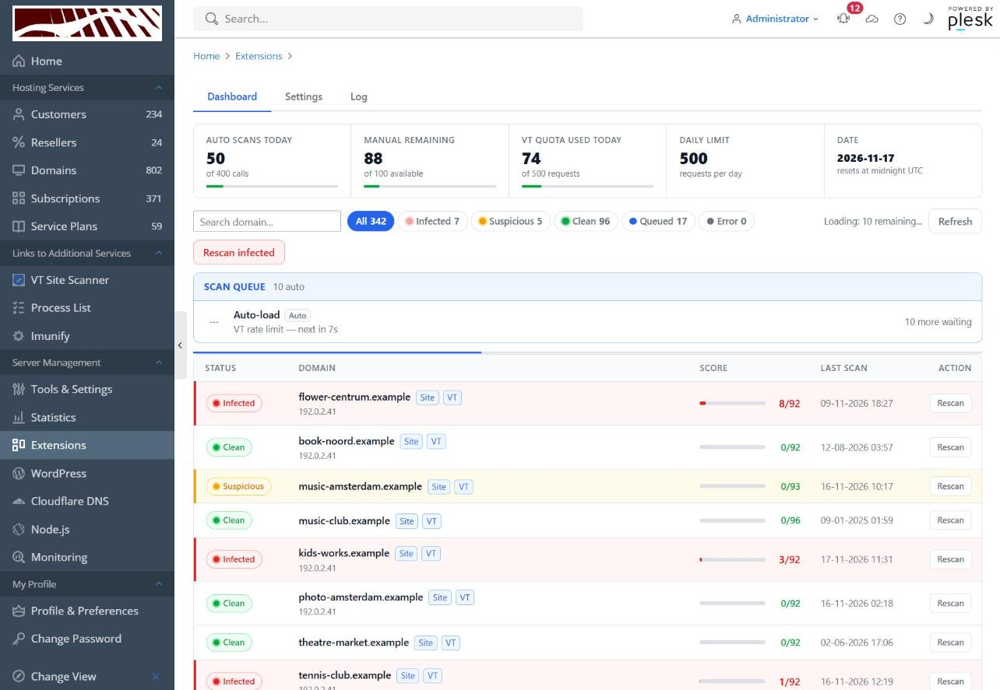
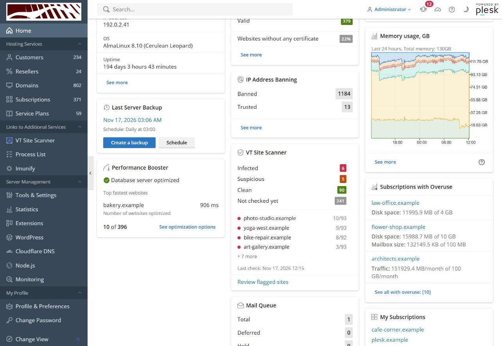

# VT Site Scanner for Plesk

A Plesk extension that checks every website hosted on your Plesk server against [VirusTotal](https://www.virustotal.com) for malware, phishing and spam, while carefully managing the limited number of API calls in VirusTotal's free tier.

Made by **Dirk Zaal** of **[Digizaal](https://www.digizaal.nl)**, a web development and hosting company in Amsterdam.

## Who it's for

Hosting companies, agencies and server admins who look after **more sites than VirusTotal's free API can check in a day**. The free key allows 500 requests per day and 4 per minute. With 500 sites or more you can't check them all every day, and a simple scanner burns the whole quota before you get to the one site you just cleaned up.

VT Site Scanner makes that quota go a long way:

- **Every site gets its turn.** The nightly scan picks up where it stopped the night before, so all sites are checked in rotation, however many there are.
- **Quota left for you.** Part of the daily budget is always kept for manual rescans.
- **No wasted calls.** Clean sites are re-checked after 30 days, infected or suspicious sites after 1 day.
- **One overview.** All sites with their status on one page and on the Plesk Home page, so a flagged site stands out right away.

## Screenshots

**Scanner dashboard:** every hosted website with its status, detection score and a Rescan button. The scan queue at the top shows what is being checked right now.



**Card on the Plesk Home page:** counts per status and the sites flagged by the most engines, straight on the admin's Home page.

<p>
  
</p>

<details>
<summary>The card in context on the Plesk Home page</summary>



</details>

*Domain names and IP addresses in these screenshots are replaced with placeholders.*

---

## Why this extension exists

Digizaal hosts about 600 WordPress sites on a single Plesk server. A single compromised site can harm its visitors, get the server's IP address blacklisted, and damage the reputation of every other site on it, so we need to know early when a site has been flagged.

With that many sites, VirusTotal's free API quota (500 requests per day) runs out every single day: checking every site even once takes more than a day, and rescans of infected sites come on top of that. Plesk ships with its own VirusTotal integration (*VirusTotal Website Check*), but it spent the whole quota with no control over which sites were checked or when. That left no room to rescan a site after cleaning it up, which is the moment you need it most.

VT Site Scanner was built to fix that:

- **Careful with API calls.** Every call goes through a rate limiter, results are cached, and the daily budget is split between background scans and manual rescans.
- **Interactive.** A live dashboard shows all sites, lets you filter on infected or suspicious ones, and rescans a site on demand, with a visible queue that shows each step of each scan.
- **Hands-off.** A nightly background scan works through all sites in turn and picks up where it left off the night before.

## Features

- Dashboard with every website hosted on the server (WordPress or not): status (Infected / Suspicious / Clean / Queued / Error), detection score (e.g. `3/93` engines), IP address, domain age and danger tags (malware, phishing, …), with direct links to the site and to its VirusTotal page.
- **Home page card** for the Plesk admin (Plesk 18.0.60 or newer): infected / suspicious / clean counts and the worst-scoring sites, styled like Plesk's own cards. It reads cached results only and never uses API calls. Show or hide it via **Home → Customize → Security → VT Site Scanner**.
- **Live scan queue**: one line showing the site being checked right now, or the latest result with its score. An animated bar shows the pause for VirusTotal's 4-requests-per-minute limit, which is waited out automatically instead of failing.
- **Nightly background scan** (03:00, server time), scheduled automatically through Plesk's own scheduler.
- **Per-role access:** the admin sees all sites, resellers see their own and their clients' sites, and clients see only their own sites. Each can use their own API key; users without one use the admin's key.
- **Log tab** with a colour-coded scan log.
- **About tab** about the maker, with a *Buy me a coffee* button.

## How it saves API calls

VirusTotal's free API allows **4 requests per minute** and **500 requests per day**.

| Mechanism | What it does |
|---|---|
| Global rate limiter | Counts every request per API key across all users and never sends more than 4/min or 500/day. |
| Result cache | Clean sites are re-checked after 30 days, infected or suspicious sites after 1 day (both configurable). Opening the dashboard reads from the cache and costs no API calls. |
| Daily budget split | By default 80% of the daily limit is reserved for the nightly scan and 20% for manual rescans. |
| Round-robin queue | The nightly scan continues where it stopped the night before, so even with hundreds of sites every site is still checked in turn. |
| One request at a time | Manual rescans go through a single queue, together with the dashboard's automatic first-time lookups. |

Every API call is a domain report lookup (`GET /domains/{domain}`), a re-analysis request (`POST /domains/{domain}/analyse`) or an analysis status check (`GET /analyses/{id}`). Only domain names are sent to VirusTotal, never site content or customer data.

---

## Requirements

- **Plesk Obsidian 18.0 or newer** on Linux, with root SSH access to the server
- Websites hosted in Plesk. Every active domain and subdomain with web hosting is checked, whatever it runs (WordPress, Joomla, plain HTML, …), plus WordPress sites on a hostname under a hosted domain. Forwarding-only domains, domains without hosting and suspended domains are skipped. The list is read from Plesk's own database. To check WordPress sites only, choose **Settings → Sites to scan → WordPress sites only**.
- A **VirusTotal API key**. The free key is enough: create an account at [virustotal.com](https://www.virustotal.com), then open your profile menu → **API key**.

The extension runs on Plesk's own bundled PHP (8.x), so the PHP version of your websites doesn't matter.

---

## Installation

### Step 1: Build the extension package

On any machine with `bash` and either `zip` or Python:

```bash
git clone https://github.com/dzaal/VT-Scanner-for-Plesk.git
cd VT-Scanner-for-Plesk
bash build.sh
```

This creates `dist/virustotal-extension-<version>.zip`.

> GitHub's green **Code → Download ZIP** button gives you the *source*, not an installable package. Always use `build.sh`, or a ready-made zip from the repository's **Releases** page if one is published.

### Step 2: Install it in Plesk

Choose **one** of the two options.

**Option A: from the command line (recommended)**

Copy the zip to the server and install it as root:

```bash
scp dist/virustotal-extension-*.zip root@your-plesk-server:/tmp/virustotal-extension.zip
```

```bash
ssh root@your-plesk-server "plesk bin extension --install /tmp/virustotal-extension.zip && rm /tmp/virustotal-extension.zip"
```

**Option B: through the Plesk interface**

Plesk only shows an upload button for your own extensions after you enable it once:

1. On the server, add these lines to `/usr/local/psa/admin/conf/panel.ini` (create the file if it doesn't exist):
   ```ini
   [ext-catalog]
   extensionUpload = true
   ```
2. In Plesk, go to **Extensions → My Extensions** and click **Upload Extension**.
3. Select the zip from step 1.

Installing registers the nightly background scan automatically. You don't need to set up a cron job.

### Step 3: Add your VirusTotal API key

1. In Plesk, open **VT Site Scanner** (in the left navigation, or under **Extensions → My Extensions**).
2. Go to the **Settings** tab.
3. Paste your API key and click **Save settings**.
4. Optional: choose **Sites to scan** (all hosted websites, or WordPress sites only), and adjust the daily limit (500 for the free tier, higher if you have a premium key), the background/manual split, and how long results are cached.

### Step 4: Check that it works

1. Open the **Dashboard** tab. Your hosted websites appear within a few seconds. Sites without a cached result are looked up gradually (at most 10 per page load, 4 per minute); the nightly scan handles the rest.
2. Click **Rescan** on any site. The **Scan queue** panel shows the scan moving through its steps.
3. Check that the nightly scan is scheduled:
   ```bash
   crontab -l -u psaadm | grep virustotal-extension
   ```
   You should see a line ending in `virustotal-extension/scripts/background_scan.php`.

To start a background scan straight away instead of waiting for 03:00:

```bash
sudo -u psaadm /usr/local/psa/admin/bin/php /usr/local/psa/admin/plib/modules/virustotal-extension/scripts/background_scan.php
```

> Always run it as `psaadm` with Plesk's PHP (`/usr/local/psa/admin/bin/php`). Running it as root leaves files the panel can't write to, and the operating system's own `php` is often too old for this code.

### Step 5 (recommended): Avoid two scanners sharing one quota

If Plesk's built-in **VirusTotal Website Check** is also active with the same API key, both draw from the same 500 requests per day, and the built-in one checks every hour. Turn it off in its own settings, or remove it:

```bash
plesk bin extension --uninstall website-virus-check
```

---

## Updating

Build the new version (step 1) and install it again (step 2). Plesk keeps your settings, API key and scan results, and the nightly task is re-registered automatically.

**Upgrading from 1.0.x?** Earlier versions asked you to add a line to root's crontab by hand. Remove that line (`crontab -e` as root, delete the line with `background_scan.php`); the extension now schedules itself.

## Uninstalling

```bash
plesk bin extension --uninstall virustotal-extension
```

This removes the extension and its scheduled task. To also delete all stored settings, results and logs (including the API key), remove the data directory:

```bash
rm -rf /usr/local/psa/var/modules/virustotal-extension
```

---

## Troubleshooting

| Problem | What to check |
|---|---|
| "No sites found" | Click **Refresh** (the site list is cached for a day). Only active domains with web hosting are listed; forwarding-only and suspended domains are skipped. |
| "Invalid API key (401)" | Re-paste the key in **Settings**; make sure there are no spaces around it. |
| Many sites stay "Queued" | VirusTotal has never seen these domains; the first lookup submits them for a scan. They resolve on a later lookup or the next nightly run. |
| Rescans say "Daily manual rescan limit reached" | The manual share of today's budget is used up. It resets at midnight UTC, or raise the percentage in **Settings**. |
| The nightly scan doesn't seem to run | Run `crontab -l -u psaadm \| grep virustotal`, then run the scan by hand (step 4) to see its output. The **Log** tab shows every run. |

## Data and privacy

All data stays on your server in `/usr/local/psa/var/modules/virustotal-extension/data/`: settings (including the API key, readable only by the panel user), cached results, budget counters and logs. Nothing is stored in this repository. The only information sent to VirusTotal is the domain names of the sites being checked.

---

## Development

```
META_INF/meta.xml            Extension metadata (id, name, version)
htdocs/index.php             Entry point (Plesk MVC bootstrap)
plib/controllers/            IndexController: page + JSON actions
plib/views/scripts/index/    Dashboard UI (vanilla JS + CSS, no build step)
plib/library/                VirusTotal client, rate limiter, cache, settings, domain discovery
plib/library/Hook/           Home page card (HomeBlock)
plib/scripts/                Nightly scan + install/uninstall hooks (scheduler registration)
plib/hooks/Home.php          Registers the Home page card (Plesk SDK hook, returns an anonymous class)
_meta/icons/                 Extension icons shown in Plesk's Extensions list
docs/                        Logo and screenshots used in this README
build.sh                     Builds dist/virustotal-extension-<version>.zip
deploy.sh                    Build + install on a server over SSH
```

Build and install in one step:

```bash
VT_DEPLOY_HOST=root@your-plesk-server bash deploy.sh
```

Notes:
- Plesk routes `?action=save-settings` to `saveSettingsAction()` (dashes become camelCase).
- For JSON responses, disable the layout with `$this->_helper->layout->disableLayout()` and set the response body. Never use `header()` or `exit` inside `pm_Application`.

## Stack

- PHP 8 (Plesk's bundled sw-engine), Zend Framework 1 (Plesk's built-in MVC)
- VirusTotal API v3
- Vanilla JavaScript and CSS, no dependencies

## Author

**Dirk Zaal**, [Digizaal](https://www.digizaal.nl), Amsterdam
